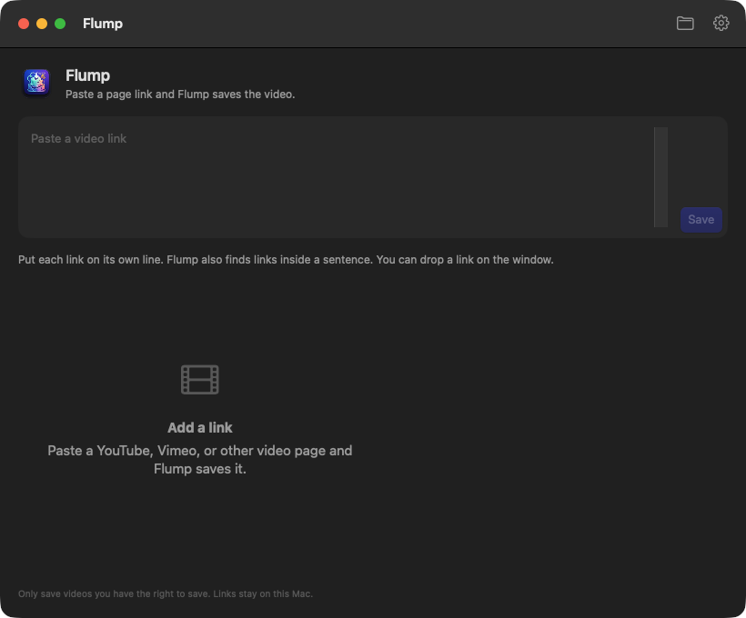

# Flump

Paste a page link and Flump saves the video. It is a native Mac app. The link stays on your machine, and [yt-dlp](https://github.com/yt-dlp/yt-dlp) figures out the site.

Flump is the cheerful one: a small creature, a link, and a file that lands in your Downloads folder.



## Download

The Mac app for Apple Silicon is in [`release/`](release/):

- [Flump-0.1.0-macos-arm64.zip](release/Flump-0.1.0-macos-arm64.zip)

Unzip it and open `Flump.app`. The build is ad-hoc signed, so the first time macOS may refuse it. Right-click the app, choose Open, or run:

```bash
xattr -cr Flump.app
```

macOS 14 or later. Apple Silicon only.

yt-dlp is inside the app. Install ffmpeg when you want separate video and audio merged, or audio only. YouTube also needs Node or Deno.

```bash
brew install ffmpeg
```

Saved files go to `~/Downloads/Flump`. Settings and history go to `~/Library/Application Support/Flump`.

## Build from source

```bash
./scripts/build-app.sh
open dist/Flump.app
```

The script runs the tests, builds the app, downloads the official yt-dlp binary into the bundle, and writes the zip in `release/`.

There is also a local browser UI, if you want it:

```bash
python3 -m venv .venv
source .venv/bin/activate
pip install -e .
python -m flump
```

## What it does

- Paste one link, many links, or a sentence that contains links. Drop a link on the window.
- Best MP4, best quality, 1080p, 720p, or audio only (M4A, MP3).
- Progress, speed, time left, cancel, and try again.
- A playlist opens a list so you can save the ones you want.
- Subtitles, when the page has them.
- Pick the save folder, then reveal the file in Finder.
- Optional cookies from Safari, Chrome, Whale, Firefox, Edge, or Brave. They stay on this Mac.
- Optional clipboard watch, only when the clipboard is nothing but links.

## Development

```bash
cd macos && swift test
pip install -e '.[dev]'
pytest
```

## Credits

Site support comes from yt-dlp. Flump does not upload the link or the file.

Only save videos you have the right to save. Follow each site's terms and the copyright on the video.

MIT License.
